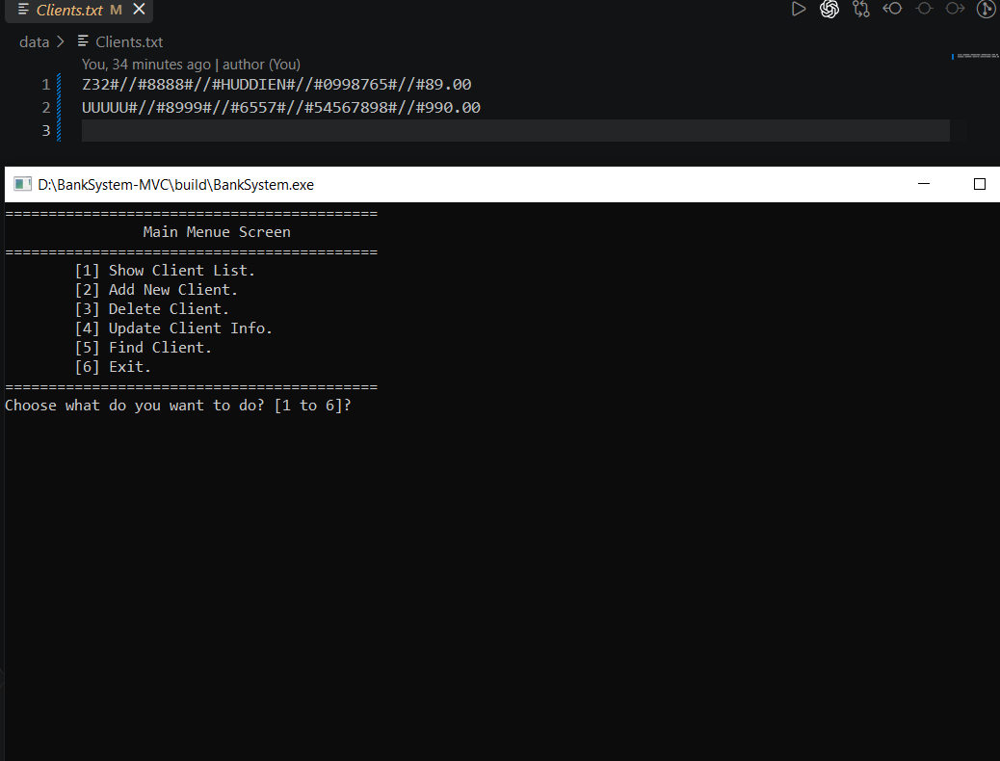
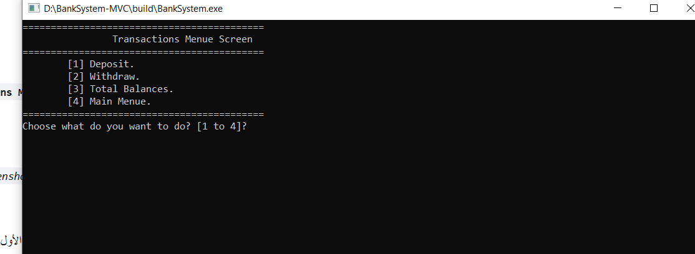
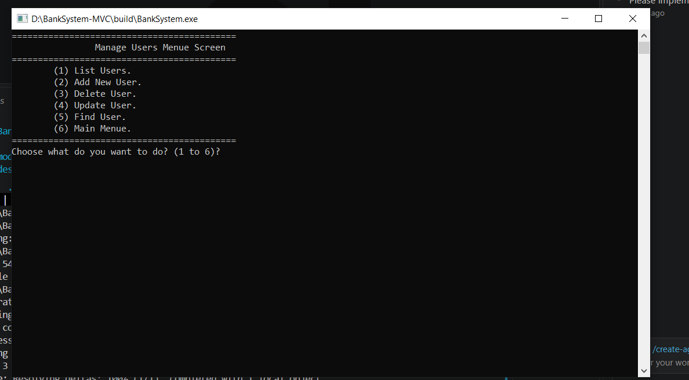

# Bank Management System (Procedural MVC - v3.0.0)

A modular C++11 command-line banking system built with strict **Procedural MVC Architecture**, zero-OOP design, bitwise role-based access control (RBAC), deterministic memory discipline, and automated unit testing.

---

## Application Preview

### 1. Core Client Management (v1.0.0)

### 2. Transactions Subsystem (v2.0.0)

### 3. User Management & RBAC Subsystem (v3.0.0)

---

## Architectural Structure

The codebase strictly separates flat-file persistence, console presentation, and workflow routing across isolated translation units:

- **include/Models & src/Models:** `Client.h`, `User.h`, `ClientRepo`, and `UserRepo`
- **include/Views & src/Views:** `ClientView`, `TransactionView`, and `UserView`
- **include/Controllers & src/Controllers:** `BankController`, `TransactionController`, and `UserController`
- **include/Utils & src/Utils:** `StringUtils` and `InputUtils`
- **tests/:** Automated assertion-based unit test runner (`test_runner.cpp`)
- **data/:** Flat-file storage (`Clients.txt` and `Users.txt`)

---

## Core Engineering Highlights

- **Zero-OOP Modular Design:** Enforces strict encapsulation using `struct`, `enum`, `namespace`, and `static` internal linkage without class overhead.
- **Bitwise RBAC Security (O(1)):** Stores 7 distinct screen capabilities inside a single 32-bit `int` bitmask evaluated via single-cycle CPU bitwise `AND`/`OR` operations.
- **Stack-Safe Session Loops:** Iterative outer/inner event loops handle `Login`, `Logout`, `Transactions`, and `Manage Users` transitions with O(1) stack memory overhead.
- **Memory Discipline & RAII:** Memory-aligned structs, `const` reference parameter passing, pre-allocated buffers (`reserve`), bounds-checked `.at()` access, and RAII file streams.
- **Compiler Strictness:** Zero warnings under `-Wall -Wextra -Werror -Wconversion`.

---

## Release History & Capabilities

- **v1.0.0 (Core Client CRUD):** List, Add, Soft-Delete, Update, and Find Clients.
- **v2.0.0 (Transactions Module):** Deposit, Withdraw (with Overdraft Guard), and Total Balances aggregation.
- **v3.0.0 (Auth & User Management):** Multi-session Login/Logout gate, User CRUD, primary `Admin` deletion guard, and granular Bitwise Permissions.

---

## Build & Run Commands (PowerShell / MinGW-w64)

### 1. Build and Launch Application (Standalone Window)
    $sources = (Get-ChildItem -Path src -Recurse -Filter *.cpp).FullName
    g++ -std=c++11 -Wall -Wextra -Werror -Wconversion -Iinclude $sources -o build/BankSystem.exe
    if ($?) { Start-Process .\build\BankSystem.exe }

Default Administrator Credentials: **Username:** `Admin` | **Password:** `1234`

### 2. Build and Execute Unit Test Suite
    g++ -std=c++11 -Wall -Wextra -Werror -Wconversion -Iinclude tests/test_runner.cpp src/Utils/StringUtils.cpp src/Utils/InputUtils.cpp src/Models/ClientRepo.cpp src/Models/UserRepo.cpp -o build/RunTests.exe
    .\build\RunTests.exe
